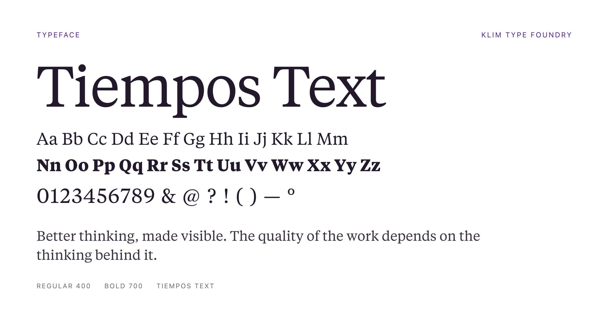
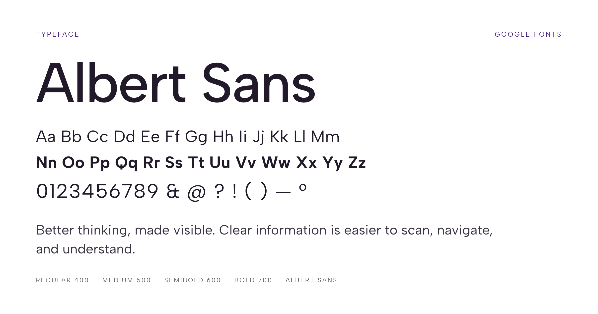

# Typography

## 1. Purpose

This document defines Numena’s typographic direction, including typeface selection, hierarchy, usage principles, and the relationship between typography and the brand’s visual identity.

Typography should make information easier to understand while contributing to Numena’s distinctive character.

The system combines two typefaces:

- **Tiempos Text** by Klim Type Foundry.
- **Albert Sans** by Google Fonts.

Together, they provide a balance between editorial character and contemporary clarity.

This document establishes the brand-level typographic direction. Exact font sizes, spacing values, responsive rules, and implementation tokens should be documented separately when the design system is developed.

## 2. Typographic Direction

Numena’s typography should communicate **clarity, thoughtfulness, credibility, and a human understanding of complexity**.

The typographic identity combines two complementary qualities:

- **Editorial and reflective:** typography that supports sustained reading and gives important ideas character.
- **Contemporary and functional:** typography that supports clear communication across digital products and brand touchpoints.

Tiempos Text provides the editorial dimension. Albert Sans provides the contemporary, versatile counterpart.

The intention is not to create contrast for its own sake. Each typeface should have a clear role, and their combination should feel deliberate and coherent.

## 3. Typeface Selection

### 3.1 Tiempos Text

<text color="secondary" size="sm">Typeface · Klim Type Foundry</text>

**Source:** [Tiempos Text — Klim Type Foundry](https://klim.co.nz/fonts/tiempos-text/)



*Specimen: an internally created sample set in Tiempos Text.*

Tiempos Text is the primary editorial typeface in Numena’s typographic identity.

Its serif design provides a more literary, considered character for content where reading, reflection, and the expression of ideas are central.

**Intended role**

- Editorial headlines and selected display statements.
- Long-form editorial content where its design and rendering are appropriate.
- Pull quotes and selected brand statements.
- Thoughtful, text-led brand communications.
- Occasional emphasis where a more expressive typographic voice is useful.

**Usage principles**

Use Tiempos Text selectively to establish an editorial character and create contrast with Albert Sans.

Its presence should feel intentional rather than decorative. It does not need to appear in every heading or every brand asset.

For long-form digital content, validate readability at the intended sizes, line lengths, and viewing conditions before establishing the final usage rules.

**Source and licensing**

Tiempos Text is commercially licensed typeface software from Klim Type Foundry. Confirm the appropriate license for each intended use, including websites, applications, self-hosted webfonts, and other distribution contexts.

Source: [klim.co.nz/fonts/tiempos-text/](https://klim.co.nz/fonts/tiempos-text/)

### 3.2 Albert Sans

<text color="secondary" size="sm">Typeface · Google Fonts</text>

**Source:** [Albert Sans — Google Fonts](https://fonts.google.com/specimen/Albert+Sans)



*Specimen: an internally created sample set in Albert Sans.*

Albert Sans is the primary functional typeface in Numena’s typographic identity.

Its sans-serif design provides a contemporary, versatile voice for information that needs to be easy to scan, navigate, and understand.

**Intended role**

- Website and product headings.
- Body text and supporting information where appropriate.
- Navigation and interface labels.
- Buttons, forms, and other functional text.
- Captions, metadata, and explanatory details.
- Presentations and structured documents.

**Usage principles**

Use Albert Sans as the default typeface for functional and informational communication.

Its role is to establish consistency and clarity across contexts, particularly where people need to scan information or interact with a product.

Use weight, size, spacing, and placement to establish hierarchy before introducing additional typographic variation.

**Source and licensing**

Albert Sans is available through Google Fonts. Verify the applicable font license and retain the required license information with the font files if they are downloaded or self-hosted.

Source: [fonts.google.com/specimen/Albert+Sans](https://fonts.google.com/specimen/Albert+Sans)

## 4. Typeface Roles

The two typefaces should have distinct, complementary responsibilities.

| Application | Primary typeface | Secondary typeface |
|---|---|---|
| Brand headlines | Albert Sans or Tiempos Text, depending on context | The alternative face for deliberate contrast |
| Editorial headlines | Tiempos Text | Albert Sans |
| Website body text | Albert Sans | Tiempos Text for selected editorial content |
| Long-form editorial content | Choose based on reading context and validation | Use the other face selectively |
| Product interface | Albert Sans | Tiempos Text only when justified |
| Navigation and controls | Albert Sans | Not normally required |
| Pull quotes | Tiempos Text | Albert Sans for attribution |
| Reports and presentations | Albert Sans | Tiempos Text for selected emphasis |
| Captions and metadata | Albert Sans | Not normally required |

These are initial brand-level guidelines, not mandatory assignments for every possible application.

The final choice should account for content, reading conditions, legibility, and the desired visual hierarchy.

## 5. Typographic Hierarchy

Typography should establish a clear order of importance.

Numena’s hierarchy should distinguish the main message from supporting information without introducing unnecessary complexity.

### Display and primary headlines

Primary headlines establish the main idea or focal point of a composition.

They may use Albert Sans for a contemporary, direct expression or Tiempos Text for a more editorial and reflective expression.

Choose the typeface according to the communication objective rather than applying both automatically.

### Section headings

Section headings organize content and help people understand its structure.

Albert Sans should generally be the default for functional section headings. Tiempos Text may be used when an editorial context benefits from its character.

### Body text

Body text should prioritize comfortable reading, appropriate line length, and clear paragraph structure.

Albert Sans is the default for general digital and product communication. Tiempos Text may be used for selected editorial formats when testing confirms that it works well in context.

### Supporting text

Captions, annotations, metadata, and secondary information should remain legible while maintaining a clear distinction from primary content.

Use size, weight, contrast, and spacing deliberately. Avoid making supporting text unnecessarily small simply to reduce its prominence.

### Emphasis

Use typographic emphasis selectively.

Weight, scale, position, and typeface contrast should communicate meaningful differences rather than create visual noise.

Avoid using every available weight or style within the same composition.

## 6. Combining the Typefaces

Tiempos Text and Albert Sans should complement one another rather than compete.

Their contrast should establish a meaningful distinction between editorial expression and functional communication.

### Preferred approach

- Use Albert Sans for the main functional structure.
- Introduce Tiempos Text where an editorial or reflective voice adds value.
- Keep each typeface's role clear within a given composition.
- Use contrast to reinforce hierarchy, not to decorate individual words arbitrarily.
- Allow either typeface to appear independently when the context does not require both.

### Avoid

- Using both typefaces indiscriminately in the same hierarchy.
- Switching typefaces between similar elements without a clear reason.
- Using Tiempos Text solely to make ordinary content appear more sophisticated.
- Using Albert Sans for every element by default when an editorial expression would better serve the content.
- Introducing additional typefaces without a demonstrated need.

The identity should remain recognizable through a consistent relationship between the two selected families.

## 7. Weight and Style

Use only the weights and styles available under the selected font licenses and included in the actual font files.

Albert Sans should provide the main range of functional hierarchy. Tiempos Text should provide the editorial range required by the intended applications.

Avoid introducing multiple weights merely because they are available.

A restrained selection makes the typographic system easier to maintain and helps preserve consistency across assets.

The exact weights to use for headlines, body text, and supporting information should be established after reviewing the available font files and testing representative compositions.

Do not assume that every weight or italic style is available in every licensed file or implementation.

## 8. Alignment, Spacing, and Readability

Typography must work as part of the overall composition.

### Alignment

Choose alignment according to the content and medium.

Left alignment is the default for most English-language and Portuguese-language body text because it supports predictable reading. Centered alignment may be appropriate for short headlines or focused brand statements.

Avoid justified body text where irregular word spacing compromises readability.

### Line length

Line length should support comfortable reading.

Long paragraphs that stretch across excessively wide areas can make it difficult to track the next line. Narrow columns may become uncomfortable when words wrap too frequently.

Determine suitable line lengths through testing in the actual layout.

### Line spacing

Line spacing should reflect the typeface, size, weight, and reading context.

Headlines may use tighter spacing when appropriate. Body text generally requires enough vertical space to distinguish successive lines comfortably.

Do not apply one universal line-spacing value to every text style.

### Letter spacing

Letter spacing should preserve the intended character of each typeface.

Use adjustments sparingly and validate them at the actual display size. Avoid excessive tracking that weakens readability or changes the visual character of the lettering.

### Paragraph structure

Use paragraph spacing, headings, and lists to make information easier to navigate.

Avoid relying on typography alone to distinguish large amounts of dense content. The overall layout should also contribute to comprehension.

## 9. Typography and Brand Character

Typography should reinforce Numena’s balance between human understanding and structured thinking.

**Tiempos Text** contributes editorial character and a more reflective visual voice.

**Albert Sans** contributes contemporary clarity and a consistent functional voice.

Neither typeface should be treated as a shortcut for communicating trust, expertise, or psychological credibility. Those qualities depend on the substance of the communication and the coherence of the broader brand.

The pairing should make Numena feel considered and approachable without becoming overly academic, clinical, or decorative.

## 10. Accessibility and Technical Considerations

Typography must remain usable across the contexts in which Numena communicates.

Consider:

- Legibility at different screen sizes and viewing distances.
- Sufficient contrast between text and background.
- Comfortable body-text sizing.
- Clear differentiation between headings and body content.
- Readability when users zoom or increase text size.
- Support for Portuguese diacritics and other characters required by the intended languages.
- Appropriate font loading and fallback behavior.
- Performance implications of loading multiple font files.
- Consistent rendering across supported browsers and operating systems.

For digital applications, verify that the selected font files contain the necessary glyphs and that the chosen weights load correctly.

Provide suitable fallback fonts and avoid hiding essential content while webfonts load.

Accessibility requirements should be validated in the actual application rather than assumed from the typeface selection alone.

## 11. Font Licensing and Asset Management

Maintain the font files, license information, and implementation references in a way that makes the typographic identity reproducible.

### Tiempos Text

Source: [Klim Type Foundry](https://klim.co.nz/fonts/tiempos-text/)

Before implementation, confirm the license required for each intended use, including website embedding, application use, and any redistribution of font files.

### Albert Sans

Source: [Google Fonts](https://fonts.google.com/specimen/Albert+Sans)

Confirm the applicable license and preserve its associated license information when downloading or self-hosting the font.

### Asset management principles

- Use authorized font files.
- Keep only the weights and styles required by the approved typographic direction.
- Preserve relevant license documentation.
- Avoid distributing licensed font files beyond the permissions granted by the license.
- Document the actual file names and font-family declarations used in implementation.
- Review font loading and fallback behavior whenever the implementation changes.

### Asset structure

```text
assets/
└── typography/
    ├── tiempos-text-specimen.png
    └── albert-sans-specimen.png
```

Font files are stored only where the applicable licenses permit (see [`assets/README.md`](../../assets/README.md)); do not create placeholder license documents that could be mistaken for actual legal terms.

## 12. Evaluation Criteria

Before approving a typographic composition, consider:

1. **Clarity:** Is the content easy to read and understand?
2. **Hierarchy:** Is the relationship between headings, body text, and supporting information clear?
3. **Consistency:** Are Tiempos Text and Albert Sans used according to their intended roles?
4. **Character:** Does the typography reinforce Numena’s editorial and contemporary qualities?
5. **Restraint:** Is variation purposeful rather than excessive?
6. **Readability:** Are line length, spacing, and size appropriate for the context?
7. **Accessibility:** Does the typography remain usable under different viewing conditions?
8. **Technical reliability:** Do the required font files, weights, and characters render correctly?
9. **Licensing:** Is the intended use covered by the relevant font license?

The objective is a coherent typographic identity, not maximum variation or strict uniformity across every medium.

## 13. Relationship to Other Documents

This document defines Numena’s typographic direction and the roles of its selected typefaces.

It works alongside the other brand documents:

- **Brand Foundation:** defines Numena’s purpose, positioning, audience, and strategic direction.
- **Brand Color Strategy:** defines the palette and its intended roles.
- **Graphic Language:** defines the principles governing shapes, lines, patterns, and other graphic elements.
- **Imagery:** defines the responsible use of photography, illustration, and abstract visuals.
- **Layout:** defines how visual elements are organized within brand communications.
- **Logo System:** defines the architecture and usage principles for the logo and its approved variants.
- **Visual Identity:** documents the finalized visual identity, including specific typographic selections and approved applications.
- **Design System (future):** translates relevant typographic decisions into implementation-ready styles, tokens, and rules for the product interface.

This document establishes the direction. The final specifications should be based on tested applications and the actual implementation requirements.

## 14. Guiding Statement

**Numena’s typography balances editorial depth with functional clarity.**

Tiempos Text gives selected communications a reflective, literary character. Albert Sans provides the clarity and versatility required for everyday communication.

Together, they create a typographic identity that is considered, contemporary, and consistent with Numena’s broader visual direction.
